# Quy Trình Nghiệp Vụ BPMN: Thu Âm Giọng Nói, Chuyển Đổi STT & Tương Tác Hội Thoại
## Quy Trình: `PROC-VOICE-CHAT` | Tham Chiếu: `FR-079`, `FR-080`, `FR-081`, `FR-082`, `BR-047`, `BR-050`

Biểu đồ BPMN mô tả các hoạt động, sự kiện bắt đầu/kết thúc và các cổng điều kiện (Gateways) trong luồng tiếp nhận giọng nói đa ngữ và chuyển đổi thành văn bản phục vụ học tập.

```mermaid
flowchart TD
    StartEvent(("Sự kiện bắt đầu:<br/>Người dùng muốn nói vào Chat"))
    
    SelectLang["Chọn ngôn ngữ nói:<br/>Tiếng Việt (vi) / Tiếng Anh (en) / Tiếng Nhật (ja) / Auto<br/>[FR-079, BR-047]"]
    
    ClickMic["Nhấn biểu tượng Microphone trên thanh Composer"]
    
    CheckPerm{"Trình duyệt đã có<br/>quyền Micro?<br/>[SEC-021]"}
    PromptPerm["Yêu cầu cấp quyền Microphone"]
    PermDenied["Thông báo lỗi & Hướng dẫn cấp quyền mic<br/>[TC-064]"]
    EndDenied(("Kết thúc luồng lỗi"))
    
    StartRecording["Khởi tạo MediaRecorder (Opus/WebM)<br/>Bắt đầu thu âm & đếm thời gian<br/>[FR-079]"]
    PulseWaveform["Hiển thị thanh sóng âm động (Waveform)<br/>[UX-015]"]
    
    CheckTimeout{"Thời lượng thu âm<br/>>= 120 giây?<br/>[BR-048]"}
    UserStopAction{"Người dùng chọn thao tác gì?"}
    
    CancelDiscard["Hủy bản ghi & Giải phóng bộ đệm âm thanh"]
    EndCancelled(("Bản ghi bị hủy"))
    
    AutoStop["Tự động ngắt thu âm ở mốc 120s"]
    StopManual["Người dùng bấm nút Dừng / Gửi"]
    
    PackageBlob["Đóng gói Audio Blob & Kiểm tra dung lượng <= 10MB<br/>[SEC-021]"]
    UploadSTT["Gửi POST /api/v1/chat/stt<br/>đến Dịch vụ Backend [OP-066]"]
    
    CheckSTT{"Xử lý STT thành công?<br/>[BR-049]"}
    FallbackPreview["Sử dụng bản nháp Web Speech API client-side<br/>[BR-049]"]
    STTSuccess["Nhận văn bản chuyển đổi chính xác<br/>từ Whisper/Gemini Engine [FR-080]"]
    
    RenderDual["Hiển thị User Message Bubble đồng thời:<br/>1. Trình phát âm thanh (Play/Pause, scrub bar)<br/>2. Phụ đề văn bản chuyển đổi [FR-081, BR-050]"]
    
    DispatchLLM["Gửi yêu cầu stream câu trả lời Sensei<br/>qua Server-Sent Events (SSE) [FR-082, OP-009]"]
    
    SenseiResponse["Sensei phản hồi: Giải thích ngữ pháp,<br/>bố cục song ngữ & âm thanh đại diện [FR-068]"]
    
    EndSuccess(("Hoàn tất chu trình hội thoại"))

    StartEvent --> SelectLang
    SelectLang --> ClickMic
    ClickMic --> CheckPerm
    CheckPerm -- Chưa có --> PromptPerm
    PromptPerm -- Bị từ chối --> PermDenied
    PermDenied --> EndDenied
    CheckPerm -- Đã cấp --> StartRecording
    PromptPerm -- Được cấp --> StartRecording
    
    StartRecording --> PulseWaveform
    PulseWaveform --> CheckTimeout
    CheckTimeout -- Có --> AutoStop
    CheckTimeout -- Không --> UserStopAction
    
    UserStopAction -- Bấm nút Hủy (Trash) --> CancelDiscard
    CancelDiscard --> EndCancelled
    
    UserStopAction -- Bấm nút Gửi/Dừng --> StopManual
    
    AutoStop --> PackageBlob
    StopManual --> PackageBlob
    
    PackageBlob --> UploadSTT
    UploadSTT --> CheckSTT
    
    CheckSTT -- Thất bại / Lỗi mạng --> FallbackPreview
    CheckSTT -- Thành công --> STTSuccess
    
    FallbackPreview --> RenderDual
    STTSuccess --> RenderDual
    
    RenderDual --> DispatchLLM
    DispatchLLM --> SenseiResponse
    SenseiResponse --> EndSuccess
```

## Nguồn Tham Chiếu
- Quy tắc điều kiện: `BR-047` (Giới hạn ngôn ngữ), `BR-048` (Giới hạn 120s & 10MB), `BR-049` (Fallback STT), `BR-050` (Hiển thị kép).
- Kiểm tra an ninh: `SEC-021` (Xác thực dung lượng và magic bytes).

