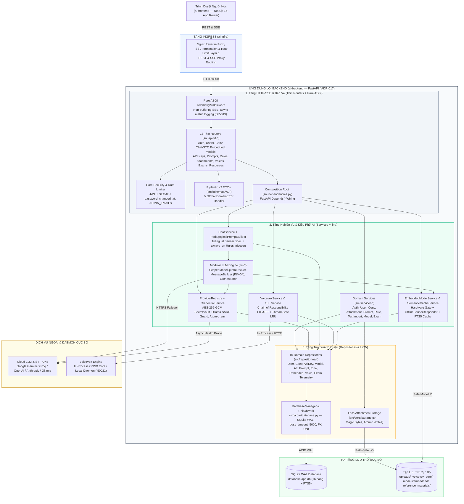

# Sơ Đồ Thành Phần Kiến Trúc (Component Architecture Diagram)
## Dự Án: Website Hỗ Trợ Học Tiếng Nhật & AI Virtual Sensei (ChatJPT)

---

| Thông Tin Sơ Đồ | Chi Tiết |
| :--- | :--- |
| **Mã Sơ Đồ** | `DIAG-COMP-001` |
| **Loại Sơ Đồ** | **C4 Component Diagram (Level 3 — ai-backend 4-Layer SOLID/KISS — `ADR-017`)** |
| **Nguồn Sự Thật Thượng Nguồn** | [docs/06-architecture/sad.md](../../docs/06-architecture/sad.md) (`ARCH-SAD-001`), [ADR-017](../../docs/06-architecture/ADR/ADR-017-backend-solid-kiss-refactoring.md), [models/architecture/architecture.yaml](../../models/architecture/architecture.yaml) |
| **Mục Đích** | Trực quan hóa kiến trúc 4 tầng thực tế bên trong `ai-backend/` (Thin Routers → Services & LLM Engine → 10 Repositories → SQLite WAL & Storage) |

---

## 1. Biểu Đồ Thành Phần Chi Tiết (C4 Component View)

