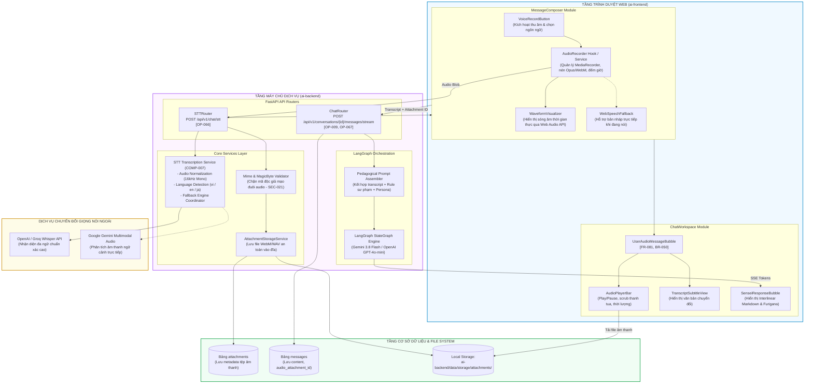

# Kiến Trúc Thành Phần: Hệ Thống Thu Âm Giọng Nói & Xử Lý STT
## Kiến Trúc: `COMP-007` | Tham Chiếu: `FR-079`, `FR-080`, `FR-081`, `FR-082`

Biểu đồ mô tả cấu trúc chi tiết các thành phần phân rã ở phía Frontend (Next.js 16) và Backend (FastAPI Core) cùng dòng kết nối giữa các module.

## Nguồn Tham Chiếu
- Thành phần: `COMP-001` (Frontend), `COMP-002` (Backend), `COMP-003` (LLM), `COMP-007` (STT Transcription Service).
- Hợp đồng API: `OP-066` (`/chat/stt`), `OP-067` (`/messages/audio-stream`).

