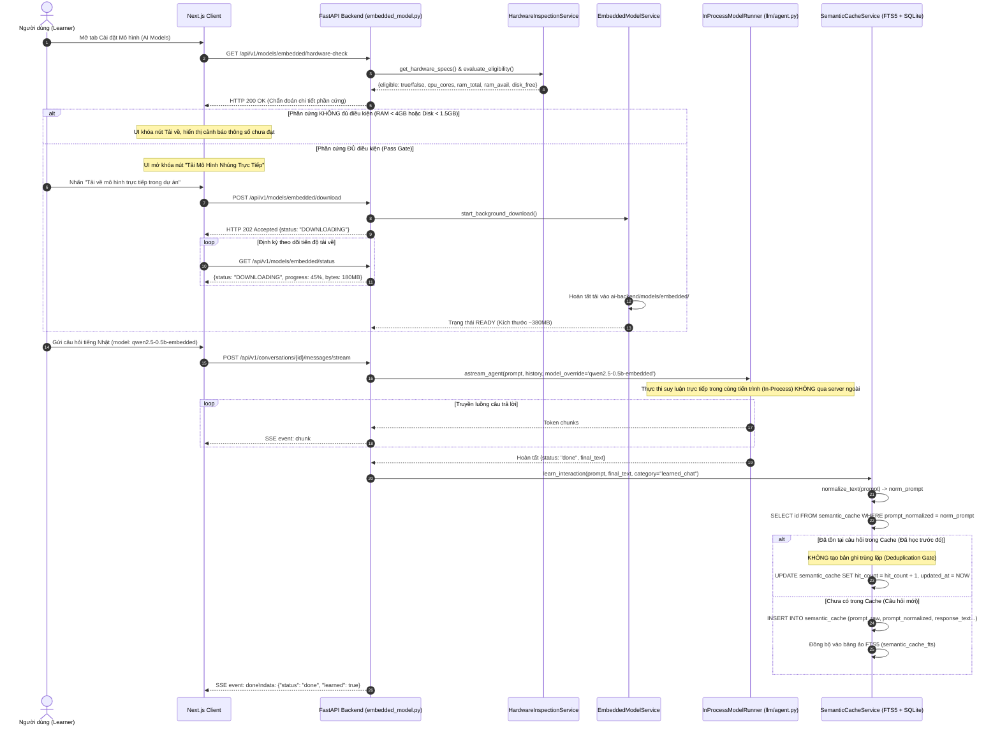

# Sơ Đồ Tuần Tự: Mô Hình Nhúng Trực Tiếp Nội Bộ & Tự Động Học Bộ Nhớ Đệm Ngữ Nghĩa (Embedded Model & Cache Auto-Learning Sequence Diagram)
## Dự Án: Website Hỗ Trợ Học Tiếng Nhật & Trợ Lý Ảo (ChatJPT)

---

| Thông Tin Sơ Đồ | Chi Tiết |
| :--- | :--- |
| **Mã Sơ Đồ** | `DIAG-SEQ-004` |
| **Mã Kịch Bản** | `SEQ-005` |
| **Nguồn Sự Thật Thượng Nguồn** | [docs/02-requirements/functional-requirements.md](file:///c:/Users/PC/Project/ChatJPT/docs/02-requirements/functional-requirements.md#FR-061), [models/api/api.yaml](file:///c:/Users/PC/Project/ChatJPT/models/api/api.yaml) |
| **Mục Đích** | Mô tả quy trình kiểm tra cổng phần cứng trước khi tải mô hình trực tiếp, thực thi suy luận in-process nội bộ dự án (không phụ thuộc server ngoài), và cơ chế tự động ghi nhớ hội thoại vào Semantic Cache có khử trùng lặp |

---

## 1. SEQ-005: Kiểm Tra Cổng Phần Cứng, Tải Mô Hình Nhúng & Tự Động Học Khử Trùng Lặp

