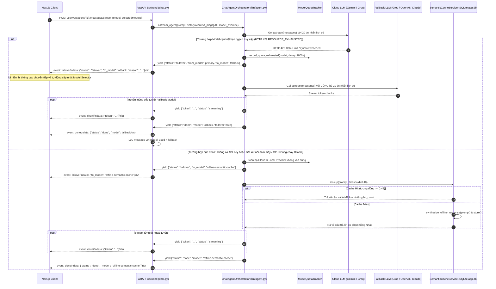

# Sơ Đồ Tuần Tự: Tự Động Chuyển Đổi Dự Phòng LLM & Bộ Nhớ Đệm Ngữ Nghĩa Ngoại Tuyến (Failover & Offline Semantic Cache Sequence Diagram)
## Dự Án: Website Hỗ Trợ Học Tiếng Nhật & Trợ Lý Ảo (ChatJPT)

---

| Thông Tin Sơ Đồ | Chi Tiết |
| :--- | :--- |
| **Mã Sơ Đồ** | `DIAG-SEQ-003` |
| **Mã Kịch Bản** | `SEQ-004` |
| **Nguồn Sự Thật Thượng Nguồn** | [docs/02-requirements/functional-requirements.md](file:///c:/Users/PC/Project/ChatJPT/docs/02-requirements/functional-requirements.md#FR-058), [models/api/api.yaml](file:///c:/Users/PC/Project/ChatJPT/models/api/api.yaml) |
| **Mục Đích** | Mô tả hành vi chuyển đổi dự phòng đa tầng khi gặp lỗi HTTP 429 Quota Exceeded (Gemini -> Groq -> OpenAI -> Claude -> Ollama CPU -> Offline Semantic Cache) và phát thông báo `event: failover` tới người dùng với toàn bộ ngữ cảnh hội thoại |

---

## 1. SEQ-004: Trình Tự Bắt Ngoại Lệ & Kích Hoạt Dự Phòng (Failover)

