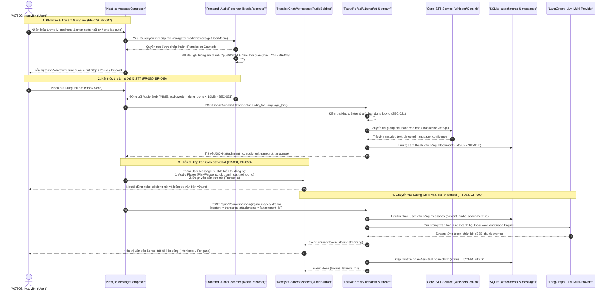

# Biểu Đồ Tuần Tự: Thu Âm Giọng Nói Đa Ngữ, Chuyển Đổi STT & Phản Hồi AI Thời Gian Thực
## Mã Kịch Bản: `SEQ-018` | Tính Năng: `FR-079`, `FR-080`, `FR-081`, `FR-082`

Biểu đồ mô tả chi tiết dòng tương tác đầu cuối từ khi Người học (`ACT-02`) kích hoạt nút thu âm giọng nói trên giao diện Next.js, chuyển đổi qua dịch vụ STT, hiển thị đồng thời sóng âm và văn bản chuyển đổi trên Chat, cho đến khi mô hình LLM tiếp nhận và phản hồi luồng SSE.

## Nguồn Tham Chiếu
- Yêu cầu chức năng: `FR-079`, `FR-080`, `FR-081`, `FR-082`
- Quy tắc nghiệp vụ: `BR-047`, `BR-048`, `BR-049`, `BR-050`
- Kiểm soát an ninh: `SEC-021`, `SEC-022`
- Hợp đồng API: `OP-066`, `OP-067`

