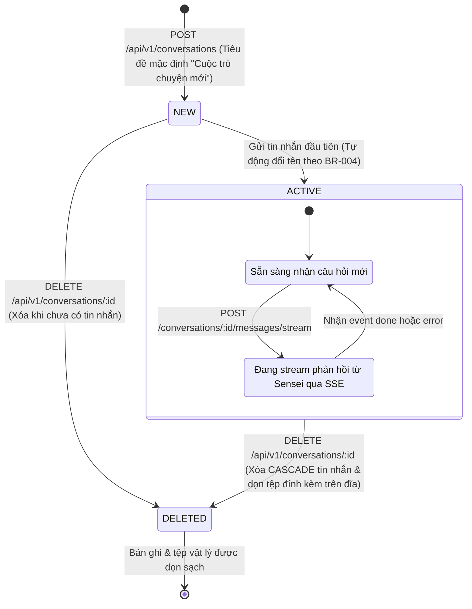

# Sơ Đồ Máy Trạng Thái: Vòng Đời Cuộc Trò Chuyện (Conversation Lifecycle State Machine)
## Dự Án: Website Hỗ Trợ Học Tiếng Nhật & AI Virtual Sensei (ChatJPT)

---

| Thông Tin Sơ Đồ | Chi Tiết |
| :--- | :--- |
| **Mã Sơ Đồ** | `DIAG-STATE-001` |
| **Mã Trạng Thái** | `STATE-001` |
| **Nguồn Sự Thật Thượng Nguồn** | [docs/09-behavior/state-machines.md](../../docs/09-behavior/state-machines.md), [docs/07-domain/domain-rules.md](../../docs/07-domain/domain-rules.md) |
| **Mục Đích** | Mô tả các trạng thái hữu hạn và các biến cố chuyển đổi trạng thái của thực thể Hội thoại (Conversation) |

---

## 1. STATE-001: Biểu Đồ Trạng Thái Cuộc Trò Chuyện

---

## 2. Bảng Thuyết Minh Chuyển Đổi Trạng Thái

| Trạng Thái Đầu | Biến Cố Kích Hoạt (Trigger) | Điều Kiện Ràng Buộc | Trạng Thái Đích | Hành Động Kèm Theo |
| :--- | :--- | :--- | :--- | :--- |
| `[*]` | Tạo hội thoại mới | Đã xác thực JWT | `NEW` | Lưu bản ghi `conversations` với tiêu đề `"Cuộc trò chuyện mới"`. |
| `NEW` | Gửi tin nhắn đầu tiên | Đủ quota (`BR-020`), đúng chủ sở hữu (`BR-002`) | `ACTIVE / PROCESSING` | Trích xuất 30 ký tự đầu làm tiêu đề tự động (`BR-004`). |
| `IDLE` | Người dùng gửi câu hỏi mới | Không đang trong luồng stream | `PROCESSING` | Mở kết nối SSE qua `ChatService.stream_events`. |
| `PROCESSING` | Nhận `event: done` hoặc `event: error` | Stream kết thúc | `IDLE` | Lưu phản hồi assistant, học Semantic Cache, ghi nhận Telemetry & trừ Quota. |
| `NEW` / `ACTIVE` | `DELETE /api/v1/conversations/:id` | Đúng `user_id` sở hữu (`BR-002`) | `DELETED` | Xóa nguyên tử hội thoại, tin nhắn CASCADE và xóa các tệp vật lý đính kèm trên đĩa. |
