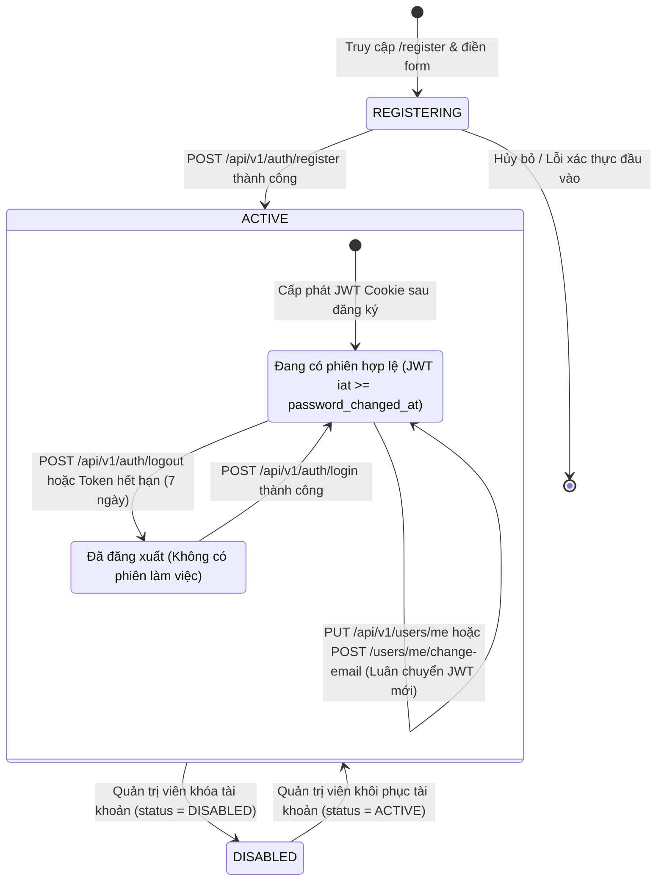

# Sơ Đồ Máy Trạng Thái: Vòng Đời Tài Khoản Người Dùng (User Account Lifecycle State Machine)
## Dự Án: Website Hỗ Trợ Học Tiếng Nhật & AI Virtual Sensei (ChatJPT)

---

| Thông Tin Sơ Đồ | Chi Tiết |
| :--- | :--- |
| **Mã Sơ Đồ** | `DIAG-STATE-004` |
| **Mã Trạng Thái** | `STATE-004` |
| **Nguồn Sự Thật Thượng Nguồn** | [docs/09-behavior/state-machines.md](../../docs/09-behavior/state-machines.md), [docs/07-domain/entities.md](../../docs/07-domain/entities.md) (`User`), [ADR-017](../../docs/06-architecture/ADR/ADR-017-backend-solid-kiss-refactoring.md) |
| **Mục Đích** | Mô tả các trạng thái hữu hạn và các biến cố chuyển đổi trạng thái tài khoản người dùng, bao gồm luân chuyển JWT khi đổi mật khẩu (`SEC-007`) hoặc đổi email |

---

## 1. STATE-004: Biểu Đồ Trạng Thái Tài Khoản Người Dùng

---

## 2. Bảng Thuyết Minh Chuyển Đổi Trạng Thái (State Transition Table)

| Trạng Thái Ban Đầu | Biến Cố Kích Hoạt (Event) | Điều Kiện Thẩm Định (Guard) | Trạng Thái Đích | Hành Động Kèm Theo (Action) |
| :--- | :--- | :--- | :--- | :--- |
| `[*]` | Khách đăng ký tài khoản | Email hợp lệ, mật khẩu >= 8 ký tự | `ACTIVE / LOGGED_IN` | Băm bcrypt, lưu `users`, cấp JWT HttpOnly Cookie (`SEC-004`). |
| `LOGGED_OUT` | Đăng nhập tài khoản | Đúng Email & Mật khẩu, `status == ACTIVE` | `LOGGED_IN` | Cấp phát JWT HttpOnly Cookie, cập nhật `last_login_at`. |
| `LOGGED_IN` | Đổi mật khẩu (`PUT /auth/password`) | Đúng mật khẩu hiện tại (`SEC-006`) | `LOGGED_IN` | Cập nhật `hashed_password` và `password_changed_at`; mọi token cũ (`iat < password_changed_at`) bị từ chối với `HTTP 401` (`SEC-007`). |
| `LOGGED_IN` | Đăng xuất (`POST /auth/logout`) | Nhấn "Đăng xuất" | `LOGGED_OUT` | Xóa Cookie `access_token`. |
| `ACTIVE` | Khóa tài khoản | Quản trị viên đổi `status = DISABLED` | `DISABLED` | `get_current_user` và `get_current_user_or_query` từ chối mọi yêu cầu bằng `HTTP 403`. |
