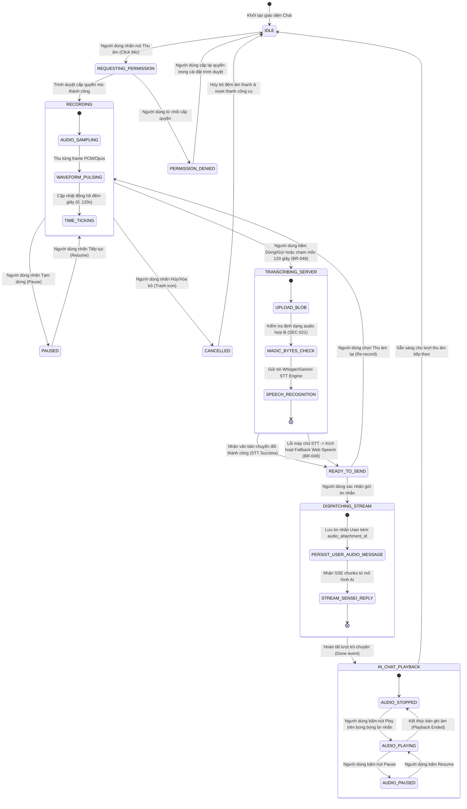

# Biểu Đồ Trạng Thái: Vòng Đời Thu Âm Giọng Nói & Xử Lý STT
## Mô Hình: `STATE-VOICE-INPUT` | Tham Chiếu: `FR-079`, `FR-080`, `FR-081`, `FR-082`

Biểu đồ mô tả các trạng thái chuyển tiếp trong suốt vòng đời của một phiên thu âm giọng nói từ khi sẵn sàng (IDLE), ghi âm, tạm dừng, xử lý chuyển đổi chữ viết (STT) cho đến khi phát lại trên khung chat.

## Nguồn Tham Chiếu
- Trạng thái bắt buộc: `IDLE`, `RECORDING`, `PAUSED`, `TRANSCRIBING_SERVER`, `READY_TO_SEND`, `DISPATCHING_STREAM`, `IN_CHAT_PLAYBACK`.
- Quy tắc điều kiện: `BR-047`, `BR-048`, `BR-049`, `BR-050`.

