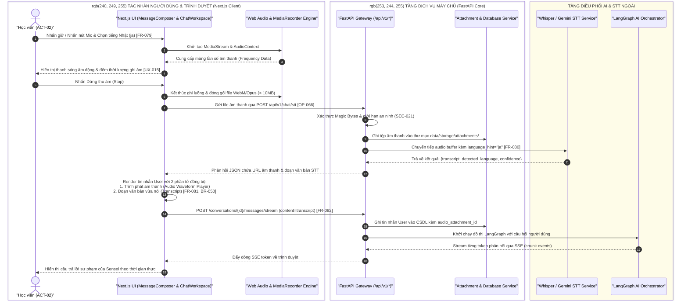

# Biểu Đồ Phân Làn Swimlane: Quy Trình Thu Âm, Nhận Diện Giọng Nói & Phản Hồi AI
## Phân Làn Trách Nhiệm: `SWIM-VOICE-CHAT` | Tham Chiếu: `FR-079`, `FR-080`, `FR-081`, `FR-082`

Biểu đồ Swimlane phân định rõ ranh giới trách nhiệm giữa Học viên, Trình duyệt Web Client, Máy chủ FastAPI Backend, Dịch vụ Nhận diện STT và Mô hình AI Ngôn ngữ.

## Nguồn Tham Chiếu
- Vai trò & Làn phân công: `User`, `UI`, `WebAudio`, `API`, `Storage`, `STTEngine`, `LLMEngine`.
- Yêu cầu liên kết: `FR-079`, `FR-080`, `FR-081`, `FR-082`, `BR-047`, `BR-050`.

