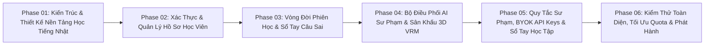

# KẾ HOẠCH PHÁT TRIỂN DỰ ÁN TỔNG THỂ (MASTER PROJECT DEVELOPMENT PLAN)
## Dự Án: ChatJPT — Hệ Sinh Thái Hỗ Trợ Học Tiếng Nhật Thông Minh (Japanese Learning Ecosystem)

---

| Thông Tin Kế Hoạch | Chi Tiết |
| :--- | :--- |
| **Dự án** | ChatJPT — Hệ Sinh Thái Hỗ Trợ Học Tiếng Nhật Tích Hợp Chatbot & Gia Sư Ảo 3D (`ChatJPT`) |
| **Mã tài liệu** | `PDP-001` |
| **Phiên bản** | v2.0.0-PIVOT |
| **Vai trò xây dựng** | Senior Business Analyst + Product Manager + Solution Architect |
| **Đầu vào chính** | Khảo sát hiện trạng kiến trúc 3 tầng (`ai-backend`, `ai-frontend`, `ai-infra`), [models/context/system-context.yaml](file:///c:/Users/PC/Project/ChatJPT/models/context/system-context.yaml), [docs/02-requirements/SRS.md](file:///c:/Users/PC/Project/ChatJPT/docs/02-requirements/SRS.md) |
| **Quy định ràng buộc** | **GIAI ĐOẠN PLANNING & ĐẶC TẢ TỔNG QUAN — TUÂN THỦ NGUYÊN TẮC SOURCE OF TRUTH & ID TRACEABILITY** |

---

## 1. Tổng Quan Dự Án & Mục Tiêu Nghiệp Vụ (Project Overview & Business Objectives)

### 1.1 Tổng Quan Dự Án (Project Overview)
Dự án **ChatJPT** là bước chuyển đổi chiến lược từ bộ khung starter đàm thoại chung sang **Hệ sinh thái nền tảng hỗ trợ học tiếng Nhật toàn diện (All-in-One Japanese Learning Ecosystem)**. 
Dự án kế thừa và phát huy tối đa các năng lực kỹ thuật đã được xây dựng sẵn trong kiến trúc cũ:
1. **Kiến trúc full-stack 3 tầng containerized**: FastAPI backend bất đồng bộ, Next.js frontend hiện đại, reverse proxy Nginx và hệ thống lưu trữ bền vững.
2. **Trợ lý AI Sư Phạm Đa Nền Tảng (Pedagogical AI Orchestrator)**: Khai thác sức mạnh của các mô hình LLM hàng đầu (Gemini, OpenAI, Claude) với cơ chế tự phục hồi (Multi-Provider Failover) để đóng vai trò **Gia sư ảo tiếng Nhật thông minh** (AI Tutor Sensei) có khả năng sửa lỗi câu, phân tích ngữ pháp theo cấp độ JLPT từ N5 đến N1, giải nghĩa Hán tự (Kanji) và đàm thoại phản xạ (Kaiwa).
3. **Gia sư ảo 3D VRM tương tác sống động (AI-Chan Sensei Companion)**: Ứng dụng Three.js và `@pixiv/three-vrm` để tạo sân khấu tương tác 3D chân thực, mô phỏng cử chỉ động viên, chớp mắt và nhịp thở tự nhiên, xóa bỏ cảm giác cô đơn khi tự học ngoại ngữ.
4. **Hệ thống Quản lý Quy tắc Sư phạm & System Prompts (Pedagogical Rules & Prompts)**: Cung cấp kho quy tắc kiểm soát ngôn ngữ, phân loại theo trình độ JLPT (N5 - N1), và hỗ trợ cơ chế nạp/xuất file bài tập nhanh chóng.
5. **Cơ chế Tùy biến Khóa API cá nhân (Bring Your Own Key - BYOK)**: Cho phép người dùng cấu hình khóa API riêng cho các nhà cung cấp AI tiên tiến (Gemini, OpenAI, Anthropic Claude, OpenRouter, DeepSeek, Groq) được mã hóa AES-256 an toàn.

### 1.2 Mục Tiêu Nghiệp Vụ Trọng Tâm (Business Objectives)
- **BO-01 (Trải nghiệm học tập trực quan & tức thì)**: Cung cấp giao diện học tiếng Nhật thân thiện, hiển thị cấu trúc câu rõ ràng (Furigana, Romaji, Hán tự, giải thích ngữ pháp tiếng Việt), phản hồi luồng ký tự qua Server-Sent Events với độ trễ bắt đầu `TTFT < 2.0s`.
- **BO-02 (Tạo động lực & Tương tác đàm thoại sống động)**: Sử dụng mô hình 3D VRM Gia sư ảo đồng hành trong suốt quá trình học, mang lại phản xạ tương tác tự nhiên trong các kịch bản đàm thoại tình huống (Roleplay Kaiwa).
- **BO-03 (Chính xác về mặt sư phạm & Ngữ cảnh văn hóa)**: Thiết lập bộ luật (Pedagogy Guardrails & Rules Library) nhằm kiểm soát chất lượng câu trả lời của AI, đảm bảo giải thích đúng ngữ pháp quy chuẩn JLPT, phân biệt rõ các sắc thái kính ngữ (Keigo, Sonkeigo, Kenjougo) và bối cảnh giao tiếp người Nhật.
- **BO-04 (Tính sẵn sàng cao & Tối ưu ngân sách token)**: Tận dụng Google Gemini làm engine chính với chi phí tiết kiệm, tự động chuyển vùng sang OpenAI/Claude khi quá tải; tích hợp bộ kiểm soát định mức hàng ngày (`quota_manager`) ngăn ngừa lạm dụng chi phí.
- **BO-05 (Cá nhân hóa tiến độ & Cô lập dữ liệu)**: Bảo đảm dữ liệu lịch sử hội thoại, nhật ký học tập, sổ tay câu sai của mỗi học viên được phân tách tuyệt đối theo quyền sở hữu (`BR-002`).

---

## 2. Chiến Lược Triển Khai Dự Án (Development Strategy)

Dự án áp dụng mô hình **Incremental, Dependency-Aware, Risk-First & Documentation-Driven Delivery**:
1. **Kế thừa kiến trúc (Architecture Reusability)**: Tận dụng 100% khung sườn backend FastAPI, frontend Next.js, database SQLite/PostgreSQL, middleware telemetry và demo supervisor đã được hoàn thiện và khóa baseline.
2. **Tài liệu dẫn dắt (Documentation-Driven)**: Mọi điều chỉnh từ khái niệm chung sang bài toán học tiếng Nhật phải được đồng bộ hóa từ Mô hình chuẩn máy đọc (`models/`) sang Tài liệu con người (`docs/`) và Biểu đồ hình chiếu (`diagrams/`).
3. **Ưu tiên rủi ro sư phạm & an toàn AI (Risk-First Pedagogical Guardrails)**: Thiết lập quy tắc phòng chống ảo giác (hallucination) trong việc phân tích chữ Hán và ngữ pháp trước khi mở rộng tính năng đàm thoại tự do.
4. **Bàn giao kiểm chứng được (Testable Milestones)**: Từng cột mốc đều có bộ tiêu chí nghiệm thu (Acceptance Criteria) và kịch bản kiểm thử tự động rõ ràng.

---

## 3. Phạm Vi Phát Triển Hệ Thống (Project Scope)

```
┌─────────────────────────────────────────────────────────────────────────────────┐
│                           CHATJPT SYSTEM SCOPE                                  │
├──────────────────────────────────────┬──────────────────────────────────────────┤
│ IN SCOPE (MVP Release)               │ OUT OF SCOPE (Đã Tách Khỏi Dự Án)        │
│ - Xác thực người dùng Email/Password │ - Studio thiết kế bài học đồ thị Node    │
│   an toàn, bảo vệ phiên qua JWT.     │   Graph phức tạp (Project Studio).       │
│ - Gia sư AI Tiếng Nhật (AI Tutor):   │ - Hệ thống Skills mở rộng & Custom Tools.│
│   • Phân tích câu & sửa lỗi văn phạm │ - Bot Discord và OAuth2 mạng xã hội.     │
│     (Grammar Doctor).                │ - Cổng thanh toán (Billing/Subscription).│
│   • Tra cứu & phân tích Hán tự Kanji │ - Ứng dụng di động bản địa Native Mobile.│
│   • Luyện đàm thoại Kaiwa phản xạ.   │ - Tự pre-train/fine-tune LLM riêng.      │
│   • Phân loại lộ trình JLPT N5 - N1. ├──────────────────────────────────────────┤
│ - Sân khấu 3D VRM Sensei Companion:  │ FUTURE SCOPE (Lộ Trình Tương Lai)        │
│   Mô phỏng nhịp thở, chớp mắt, xoay  │ - Đàm thoại giọng nói 2 chiều AI Sensei  │
│   360 độ, cử chỉ động viên tự nhiên. │   (Web Speech API / Whisper).            │
│ - Quản lý Prompts & Rules Sư phạm:   │ - RAG tài liệu PDF giáo trình học        │
│   Cơ chế kích hoạt linh hoạt 4 tầng. │   (Minna no Nihongo, Soumatome, v.v.).   │
│ - Đính kèm tệp văn bản bài học.      │ - Thi thử JLPT bấm giờ & Bảng xếp hạng   │
│ - BYOK API Keys (AES-256 mã hóa).    │   vinh danh học viên (Leaderboard).      │
│ - Bộ đếm định mức token hàng ngày.   │                                          │
└──────────────────────────────────────┴──────────────────────────────────────────┘
```

---

## 4. Các Nhóm Năng Lực Cốt Lõi (Core Capabilities)

| Nhóm Năng Lực | Mã Năng Lực | Yêu Cầu SRS & Quy Tắc | Độ Ưu Tiên | Trạng Thái Hiện Tại |
| :--- | :--- | :--- | :--- | :--- |
| **Kiến Trúc & Hạ Tầng Cơ Sở** | `CAP-FOUNDATION` | Kiến trúc 3 tầng, `ARCH-001`, `ADR-002` | `Must Have` | **READY / BASELINED** |
| **Xác Thực & Quản Lý Học Viên** | `CAP-AUTH` | `FR-001..003`, `FR-027..028`, `BR-001` | `Must Have` | **IMPLEMENTED** |
| **Quản Lý Phiên Học & Lịch Sử** | `CAP-CONV` | `FR-004..007`, `FR-012`, `BR-002` | `Must Have` | **IMPLEMENTED** |
| **Trợ Lý AI Sư Phạm Tiếng Nhật** | `CAP-JAPANESE-AI` | `FR-008..011`, `FR-013..014`, `BR-005` | `Must Have` | **ENHANCED WITH JAPANESE PROMPTS** |
| **Gia Sư Ảo 3D VRM Đồng Hành** | `CAP-VRM-TUTOR` | `FR-048..056`, `BR-035`, `ADR-013` | `Must Have` | **IMPLEMENTED** |
| **Studio Pipeline Bài Giảng** | `CAP-PROJECT-STUDIO` | `FR-057`, `BR-036..039`, `ADR-014` | `Retired` | **RETIRED** (Tách khỏi phạm vi web học tập) |
| **Thư Viện Quy Tắc & Prompts Học** | `CAP-RULES-PROMPTS` | Rules sư phạm, Prompts N5-N1, Import file | `Must Have` | **IMPLEMENTED** |
| **Quản Lý API Key & Quota Học Tập** | `CAP-RES-MGMT` | `FR-029..034`, `BR-019..021`, `SEC-015` | `Must Have` | **IMPLEMENTED** |
| **Bot Học Tập Cộng Đồng Discord** | `CAP-DISCORD-BOT` | `FR-044..046`, `BR-031..034`, Multi-bot | `Retired` | **RETIRED** (Tách khỏi phạm vi web học tập) |

---

## 5. Phân Kỳ Phát Triển Hệ Thống (Development Phases)



- **Phase 01 (System Architecture & Japanese Pedagogy Models)**: Chuẩn hóa System Context, Canonical Models và bộ danh mục System Prompts chuyên ngành tiếng Nhật (JLPT N5-N1, Kaiwa, Grammar Doctor).
- **Phase 02 (Authentication & Student Profile Management)**: Xác thực tài khoản, hỗ trợ đăng nhập Discord OAuth2 cho học viên cộng đồng, bảo vệ thông tin học viên qua JWT Cookie và mã hóa mật khẩu bcrypt.
- **Phase 03 (Learning Session Lifecycle & Data Isolation)**: Quản lý các phiên hội thoại học tập theo từng chủ đề (Văn phạm, Từ vựng, Kanji, Đàm thoại), cách ly dữ liệu cá nhân theo `BR-002`.
- **Phase 04 (Japanese AI Orchestrator & 3D VRM Sensei Companion)**: Kích hoạt bộ điều phối AI đa nhà cung cấp, streaming phản hồi phân tích ngữ pháp tiếng Nhật ra giao diện, kết nối động cơ chuyển động tự nhiên của mô hình 3D VRM.
- **Phase 05 (Pedagogical Rules, BYOK Keys & User Experience)**: Cung cấp giao diện quản lý quy tắc sư phạm, thư viện prompt JLPT, quản lý khóa BYOK API Keys an toàn và sổ tay lưu trữ câu hỏi.
- **Phase 06 (Testing, Quota Optimization & Release Readiness)**: Kiểm toán truy vết, xác thực độ trễ TTFT < 2s, kiểm tra an toàn dữ liệu và đóng gói bản phát hành.

---

## 6. Kế Hoạch Các Cột Mốc Bàn Giao (Milestones Plan)

| Mã Mốc | Tên Cột Mốc | Mục Tiêu Bàn Giao Cụ Thể | Tiêu Chí Nghiệm Thu Thoát Mốc |
| :---: | :--- | :--- | :--- |
| **M01** | **Japanese Architecture & Docs Baseline** | Hoàn tất cập nhật bộ tài liệu tổng quan, phạm vi, tác nhân, system context và yêu cầu hệ sinh thái học tiếng Nhật. | Kiểm toán tính toàn vẹn 0 lỗi qua `tools/validators/run_all.py`. |
| **M02** | **Student Identity & Personalization Ready**| Học viên đăng ký, đăng nhập tài khoản an toàn; cấu hình API Key cá nhân (nếu có) được mã hóa AES-256-GCM. | Vượt qua bài kiểm tra xác thực và mã hóa bí mật. |
| **M03** | **Interactive Learning Session Foundation** | Quản lý danh sách các buổi học trên Sidebar, phân tách phiên học theo chủ đề ôn thi JLPT và Kaiwa. | Bảo đảm bất biến cách ly dữ liệu `BR-002`. |
| **M04** | **AI Tutor Sensei & 3D Companion Live** | Chatbot tiếng Nhật phân tích câu chính xác, stream mượt mà, avatar 3D VRM biểu cảm đồng bộ và tự động fallback model khi nghẽn mạng. | Độ trễ bắt đầu stream TTFT < 2.0s (`NFR-003`). |
| **M05** | **Focused Japanese Web Platform Release** | Nền tảng Web học tiếng Nhật tập trung (Kaiwa, 3D VRM Sensei, Rules, Prompts, BYOK) hoàn tất đóng gói chạy qua `run-demo.bat`. | Vượt qua toàn bộ bộ kiểm thử tích hợp và nghiệm thu phát hành. |

---

## 7. Định Nghĩa Sản Phẩm Tối Thiểu (MVP Definition for ChatJPT)

Sản phẩm MVP mang lại giá trị cốt lõi tức thì cho người học tiếng Nhật:
1. **Không gian học đàm thoại tiếng Nhật (Japanese Learning Chat Workspace)**:
   - Hỗ trợ nhập và hiển thị chữ Nhật (Hiragana, Katakana, Kanji, Romaji).
   - Chế độ **Grammar Doctor**: Phân tích lỗi ngữ pháp trong câu của học viên, giải thích nguyên nhân và đưa ra câu mẫu chuẩn tự nhiên.
   - Chế độ **JLPT Assistant**: Giải thích điểm ngữ pháp N5 đến N1 kèm ví dụ song ngữ.
2. **Gia sư ảo 3D VRM tương tác sống động**:
   - Nhân vật 3D anime (AI-Chan Sensei) hiện diện trực tiếp trên màn hình học tập, hỗ trợ 2 chế độ (Workspace và Fullscreen Companion).
3. **Thư viện mẫu Prompt học tập & Quy tắc chuẩn mực**:
   - Cung cấp sẵn các prompt mẫu luyện Kaiwa (Đi combini, Hỏi đường, Phỏng vấn xin việc baito, Nói chuyện bạn bè).
4. **Hệ thống giám sát tài nguyên & Quota học tập**:
   - Hiển thị lượng token tiêu thụ và cảnh báo khi chạm định mức học tập hàng ngày.
5. **Cơ chế chuyển vùng dự phòng AI tự động**:
   - Bảo đảm quá trình học tập của học viên không bị gián đoạn giữa chừng khi một API nhà cung cấp gặp sự cố.

---

## 8. Quản Trị Rủi Ro Trọng Tâm (Critical Risks & Mitigations)

| Mã Rủi Ro | Phân Loại | Mô Tả Rủi Ro | Mức Độ | Biện Pháp Giảm Thiểu Kỹ Thuật |
| :---: | :--- | :--- | :---: | :--- |
| **RSK-PED-01** | Sư Phạm / AI | AI sinh thông tin sai lệch về ngữ pháp hoặc bịa đặt cách đọc Kanji hiếm (Hallucination). | **HIGH** | Cài đặt Prompt Guardrail nghiêm ngặt: yêu cầu AI trích dẫn cấp độ JLPT, cung cấp Furigana chuẩn và nêu rõ nếu là cách dùng thông tục. |
| **RSK-AI-01** | Dịch Vụ AI | Nhà cung cấp chính (Gemini) bị giới hạn rate limit hoặc gián đoạn mạng. | **HIGH** | Kích hoạt tự động chuyển vùng dự phòng sang OpenAI/Claude đã tích hợp sẵn trong backend orchestrator (`BR-005`). |
| **RSK-SEC-01** | Bảo Mật | Học viên nhập thông tin nhạy cảm hoặc rò rỉ API key cá nhân. | **CRITICAL** | Toàn bộ khóa API lưu trữ trong cơ sở dữ liệu đều được mã hóa AES-256-GCM (`SEC-015`), mặt nạ hóa khi hiển thị trên giao diện. |
| **RSK-COST-01**| Chi Phí | Học viên thực hiện spam câu hỏi dài gây cạn kiệt ngân sách token. | **HIGH** | Thực thi trần giới hạn độ dài tin nhắn 4,000 ký tự (`BR-003`), rate limit 60 req/phút/IP và bộ quản lý định mức hàng ngày. |
| **RSK-PERF-01**| Hiệu Năng | Render 3D VRM gây giật lag trên máy cấu hình yếu của học viên. | **MEDIUM** | Tối ưu hóa WebGL Three.js, hỗ trợ nút thu gọn 3D Stage về chế độ Minimal Workspace chỉ hiển thị khung chat văn bản. |

---

## 9. Khuyến Nghị Hành Động Kỹ Thuật Tiếp Theo (Next Steps)

1. Cập nhật tài liệu đặc tả yêu cầu **[docs/02-requirements/SRS.md](file:///c:/Users/PC/Project/ChatJPT/docs/02-requirements/SRS.md)** để chuyển đổi các use case và yêu cầu chức năng sang bài toán học tiếng Nhật.
2. Chuẩn hóa thư viện prompts tiếng Nhật trong cơ sở dữ liệu và thư mục `models/` (JLPT N5-N1 prompts, Kaiwa roleplay scenarios).
3. Duy trì kiểm toán tính nhất quán của hệ thống tài liệu qua lệnh kiểm tra tự động `python tools/validators/run_all.py`.
