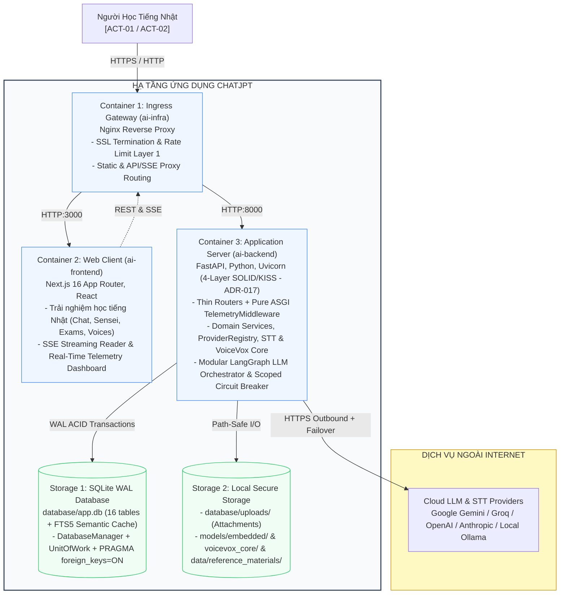
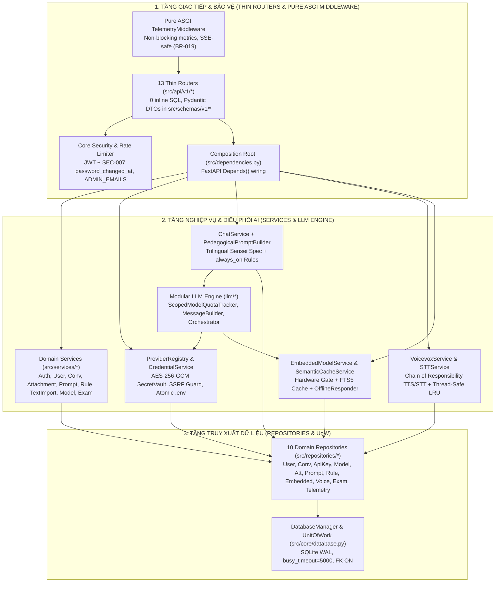

# TÀI LIỆU ĐẶC TẢ KIẾN TRÚC PHẦN MỀM (SOFTWARE ARCHITECTURE DOCUMENT - SAD)
## Hệ Thống Website Chatbot Trợ Lý Ảo (AI-Chan Assistant)

---

| Thông Tin Tài Liệu | Chi Tiết |
| :--- | :--- |
| **Dự án** | Hệ Sinh Thái Học Tiếng Nhật ChatJPT (`chatjpt`) |
| **Mã tài liệu** | `ARCH-SAD-001` |
| **Trạng thái Baseline** | **BASELINED (UPDATED — ADR-017)** |
| **Mục đích** | Mô tả kiến trúc tổng thể của hệ thống dựa trên mô hình C4 (Context, Container, Component), xác lập kiến trúc 4 tầng chuẩn SOLID/KISS và lựa chọn công nghệ thực tế |

---

## 1. Mục Tiêu Kiến Trúc & Nguyên Tắc Thiết Kế (Architectural Drivers)

1. **Hiệu Năng & Độ Trễ Thấp (Performance & Low Latency)**: Tối ưu hóa thời gian bắt đầu stream phản hồi dưới 2 giây (`NFR-003`) thông qua Server-Sent Events (SSE).
2. **Độ Sẵn Sàng & Tính Tự Phục Hồi (High Availability & Resilience)**: Không phụ thuộc vào một nhà cung cấp duy nhất; tự động chuyển vùng dự phòng (Failover) từ Google Gemini sang OpenAI (`BR-005`, `NFR-008`).
3. **Bảo Mật Phòng Thủ Theo Chiều Sâu (Defense in Depth)**: Kiểm soát tần suất 2 tầng (`BP-SEC-001`), băm mật khẩu bcrypt (`SEC-002`), bảo vệ phiên bằng HttpOnly Secure Cookie (`SEC-004`) và cách ly dữ liệu cá nhân triệt tiêu lỗ hổng IDOR (`BR-002`, `NFR-018`).
4. **Kiến Trúc Tối Giản & Dễ Vận Hành (Simplicity - Ponytail Senior Dev Mode)**: Cấu trúc 3 tầng (3-tier) containerized rõ ràng, không thêm thấu kính phức tạp khi chưa có yêu cầu; đóng gói hoàn chỉnh qua Docker Compose.

---

## 2. Mô Hình Kiến Trúc C4 — Cấp Độ 2: Container View

---

## 3. Mô Hình Kiến Trúc C4 — Cấp Độ 3: Component View (ai-backend 4-Layer SOLID — ADR-017)

---

## 4. Công Nghệ Chủ Đạo & Cơ Sở Lựa Chọn (Technology Stack Rationale)

1. **Backend Core (FastAPI, Python, Uvicorn — `ADR-017`)**: Kiến trúc 4 tầng chuẩn SOLID/KISS (`Routers -> Services -> Repositories -> Core/SQLite`), tách biệt hoàn toàn Pydantic DTO (`src/schemas/v1/`), domain entity (`src/models/v1/`), và xử lý lỗi miền tập trung qua `DomainError`.
2. **Frontend UI (Next.js 16 App Router & React)**: Hỗ trợ trải nghiệm học tiếng Nhật tương tác (Furigana Ruby, tô màu ngữ pháp, trình phát giọng nói VoiceVox, thi thử JLPT và Dashboard Telemetry SSE).
3. **Database (SQLite WAL + FTS5)**: Tối ưu vận hành cục bộ gọn nhẹ (KISS), kích hoạt Write-Ahead Logging (`WAL`), `busy_timeout=5000`, `PRAGMA foreign_keys = ON`, quản trị giao dịch nguyên tử qua `UnitOfWork`, và chỉ mục toàn văn `FTS5` cho 10,000+ mục Semantic Cache.
4. **AI Agent Engine (`llm/` — `ADR-005`, `ADR-017`)**: Tách riêng `ScopedModelQuotaTracker` (circuit breaker cô lập theo `user_id`), `message_builder.py` (cửa sổ trượt 20 tin nhắn `INV-04` + trích xuất đính kèm đa phương thức), và `orchestrator.py` ủy quyền khởi tạo model cho `ProviderRegistry`.
5. **VoiceVox TTS & Multilingual STT (`ADR-015`, `ADR-008`, `ADR-017`)**: Áp dụng mẫu **Chain of Responsibility** (VoiceVox Embedded Core → Daemon → Acoustic Fallback không cache; Groq Whisper → OpenAI Whisper → Gemini Audio → Heuristic) cùng `asyncio.to_thread` tránh chặn event loop.

---

## 5. Kiến Trúc Mở Rộng: Module Nhập Liệu Giọng Nói & STT (FEAT-006, ADR-008)

### 5.1 Quyết Định Kiến Trúc ADR-008: Hybrid STT Pipeline
- **Bối cảnh**: Người học tiếng Nhật cần luyện tập phản xạ giao tiếp Kaiwa bằng giọng nói (tiếng Việt, tiếng Anh, tiếng Nhật) thay vì chỉ gõ phím.
- **Quyết định**: Áp dụng kiến trúc lai (Hybrid Dual-Mode STT Pipeline):
  1. *Client-Side Capture*: Sử dụng Web Audio API kết hợp MediaRecorder API nén chuẩn Opus/WebM (24-32kbps Mono 16kHz) trực tiếp trong trình duyệt để giảm tải băng thông mạng (NFR-022).
  2. *Server-Side STT Engine (COMP-007)*: Máy chủ FastAPI tiếp nhận tệp âm thanh qua endpoint POST /api/v1/chat/stt (OP-066), xác thực Magic Bytes (SEC-021), lưu trữ tệp vào bảng ttachments và điều phối sang OpenAI Whisper hoặc Google Gemini Multimodal Audio để nhận diện đa ngữ chính xác cao (FR-080, BR-047).
  3. *Dual-Display Message Bubble*: Tin nhắn của người dùng trong khung chat hiển thị song song cả trình phát âm thanh (Audio Player) và đoạn văn bản chuyển đổi (Transcript) để người học tự kiểm tra phát âm của bản thân (FR-081, BR-050, UX-016).
  4. *Direct LLM Ingestion*: Đoạn văn bản sau STT được đưa trực tiếp vào đồ thị LangGraph Agent để Sensei phân tích ngữ pháp liên dòng và phản hồi thời gian thực qua luồng Server-Sent Events (FR-082, OP-067).
