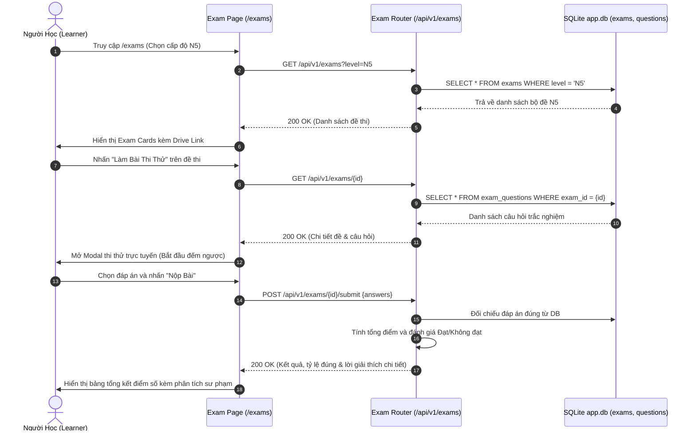
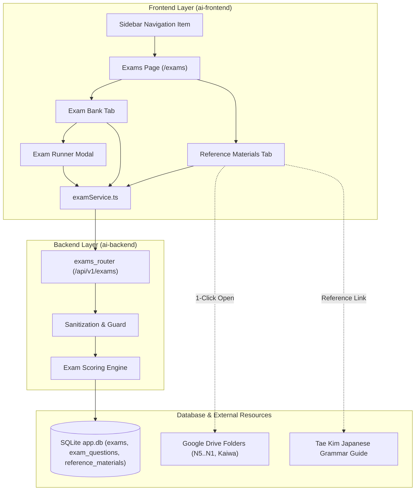
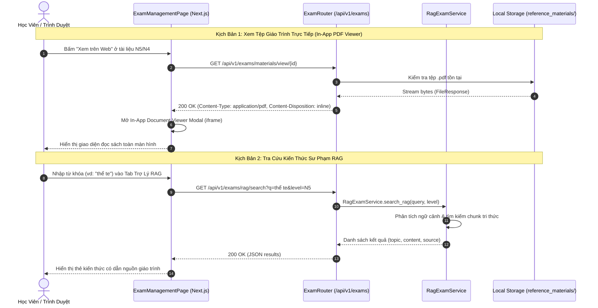

# Mermaid Diagrams: Exam Management Architecture & Flows

## 1. Sequence Diagram: Luồng Khám Phá & Thi Thử Trực Tuyến (`SEQ-016`)

---

## 2. Component Diagram: Cấu Trúc Thành Phần Hệ Thống (`COMP-006`)

## 4. Sequence Diagram: Tải & Xem Tệp Cục Bộ và Tra Cứu RAG (`SEQ-017`)

