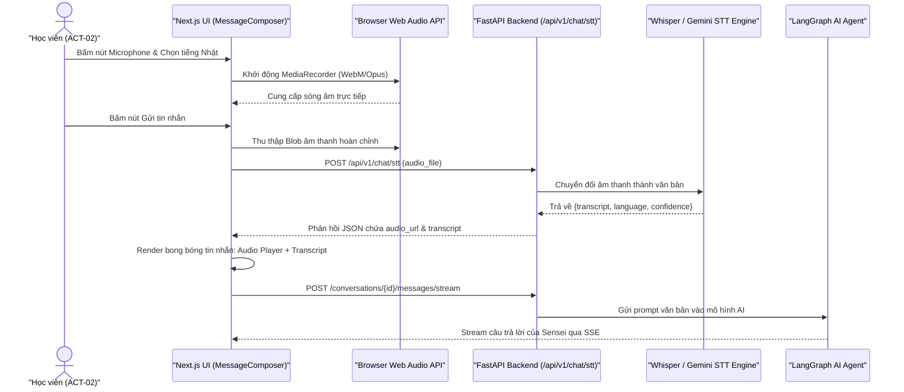
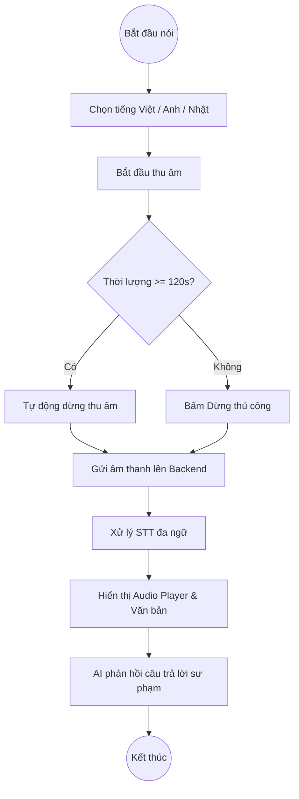
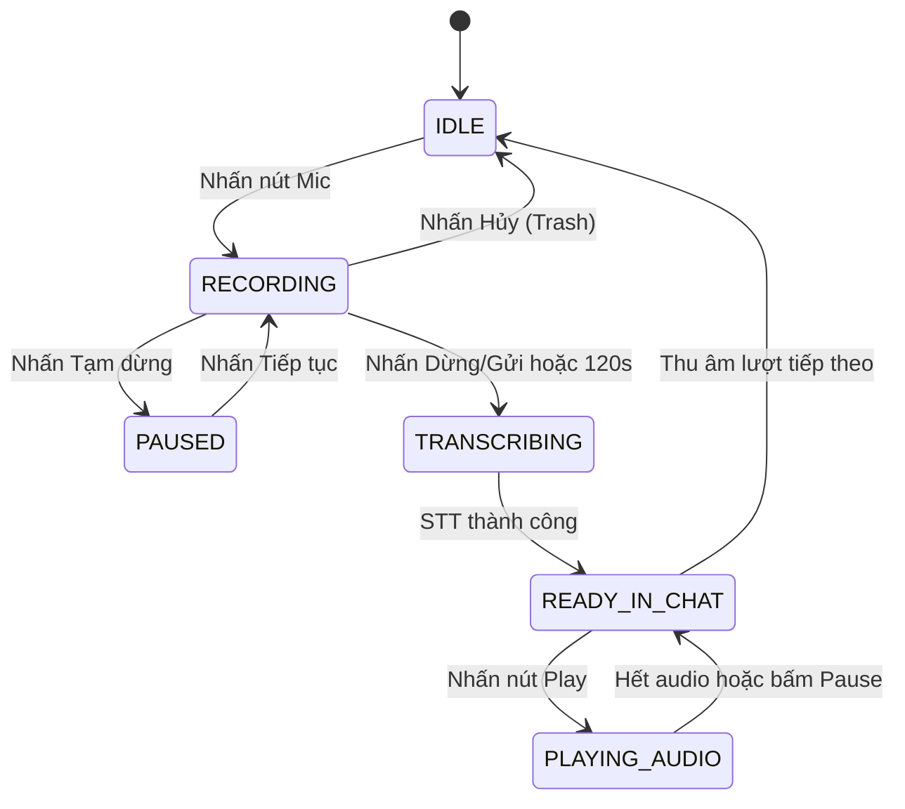

# Tổng Hợp Biểu Đồ Trực Quan Mermaid: Voice Input & STT
## Phân Hệ: Voice Input & STT | Tính Năng: `FEAT-006`

Tài liệu này tổng hợp toàn bộ các biểu đồ kỹ thuật phục vụ việc phát triển, kiểm thử và bảo trì tính năng Thu âm Giọng nói Đa ngữ & STT.

---

## 1. Biểu Đồ Tuần Tự (Sequence Diagram - `SEQ-018`)

---

## 2. Biểu Đồ Luồng Nghiệp Vụ (BPMN - `PROC-VOICE-CHAT`)

---

## 3. Biểu Đồ Vòng Đời Trạng Thái (State Diagram - `STATE-VOICE-INPUT`)

