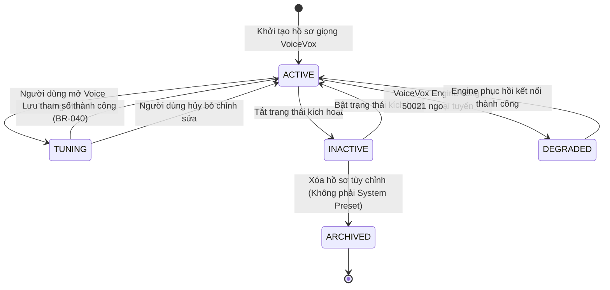
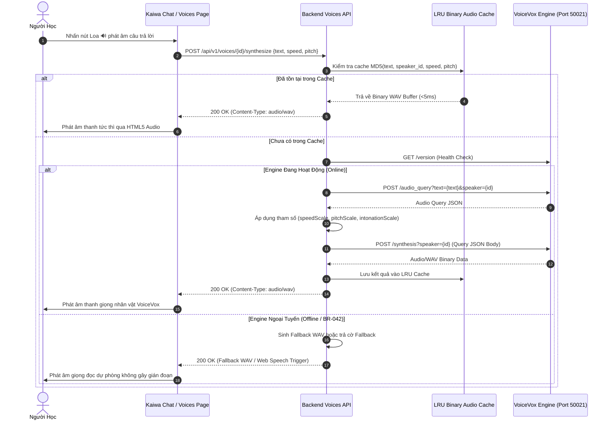
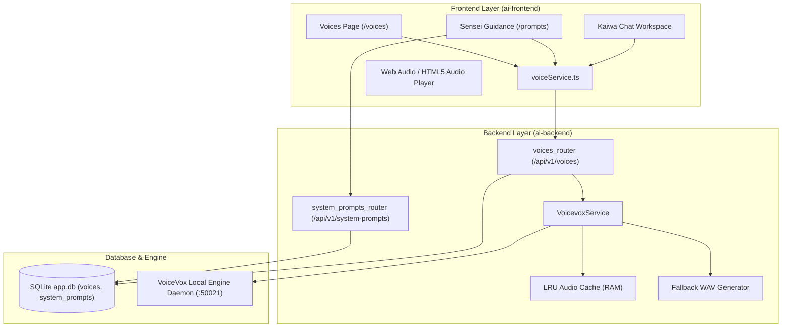

# Mermaid Diagrams: Voice Management Architecture & Flows

## 1. State Diagram: Vòng Đời Giọng Nói & Trạng Thái Engine (`STATE-VOICE-01`)

---

## 2. Sequence Diagram: Luồng Tổng Hợp & Phát Âm Thanh (`SEQ-VOICE-01`)

---

## 3. Component Diagram: Cấu Trúc Thành Phần Hệ Thống (`COMP-005`)

---

## 4. Sequence Diagram: Luồng Phân Giải & Phát Giọng Sensei Trong Hội Thoại (SEQ-VOICE-02)

`mermaid
sequenceDiagram
    autonumber
    actor Learner as Người Học (Learner)
    participant UI as ChatWorkspace (/chat)
    participant ChatAPI as Chat Stream API (/chat.py)
    participant DB as SQLite app.db (messages, system_prompts)
    participant VoiceAPI as Voices API (/voices.py)
    participant Engine as VoiceVox Engine Core / Daemon

    Learner->>UI: Chọn Sensei (e.g. Yuki Sensei N1 - voice_shikoku_metan)
    UI->>UI: Lưu activeSenseiVoiceId & localStorage('ai_chan_selected_sensei_voice')
    Learner->>UI: Gửi câu hỏi Kaiwa
    UI->>ChatAPI: POST /conversations/{id}/messages/stream {sensei_id, model, ...}
    ChatAPI->>DB: Truy vấn system_prompts lấy voice_id
    DB-->>ChatAPI: voice_id: 'voice_shikoku_metan'
    ChatAPI->>DB: Lưu Assistant Message với (sensei_id, voice_id)
    ChatAPI-->>UI: SSE event: done {message_id, sensei_id, voice_id}
    UI->>UI: Cập nhật message state kèm sensei_id & voice_id
    
    Learner->>UI: Nhấn biểu tượng Loa 🔊 trên câu trả lời
    UI->>VoiceAPI: POST /api/v1/voices/voice_shikoku_metan/synthesize {text}
    Note over VoiceAPI: Nếu gọi bằng sensei_id, backend tự động tra cứu voice_id từ system_prompts
    VoiceAPI->>Engine: Tổng hợp âm thanh theo speaker_id của Shikoku Metan (ID 0)
    Engine-->>VoiceAPI: Binary WAV Stream
    VoiceAPI-->>UI: 200 OK (Content-Type: audio/wav)
    UI->>Learner: Phát âm giọng đọc đặc trưng của Yuki Sensei
`
